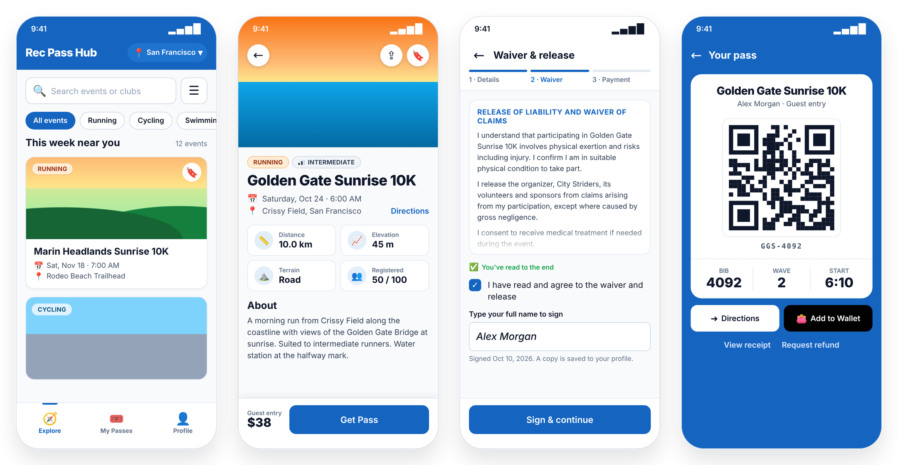
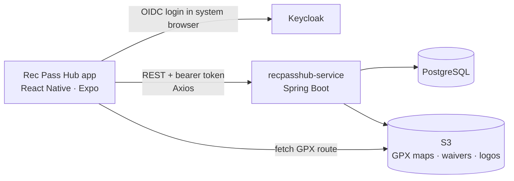

# Rec Pass Hub: Mobile App

A React Native app for discovering local running, cycling, swimming and triathlon events, signing the waiver, and carrying your event pass on your phone. Organizers use the same app to build events, check attendees in with a QR scanner and message participants.

   



*Hi-fi designs for the attendee flow, from left: the explore feed of nearby events, event details with course stats, signing the waiver during checkout, and the race-day pass with its QR code.*

## What it does

**For attendees**
- **Explore nearby events.** The app uses the phone's location to load events within a radius, with filters by sport.
- **Event details.** Distance, elevation, terrain and capacity, plus the course drawn on a map from the organizer's GPX file.
- **Checkout.** A step-by-step registration flow in which the attendee reviews and signs the event's waiver.
- **My Passes.** Each pass carries a QR code that organizers scan at check-in.
- **Notifications and messages** from organizers.

**For organizers**
- **Event studio.** A multi-step builder for creating and editing events: details, location, course map (GPX upload), waiver and logo, then a review step before publishing.
- **Dashboard** of their events.
- **QR check-in.** The camera scans attendee passes at the start line.
- **Messages** to the people registered for an event.

## How it fits together



- **Sign-in:** Keycloak OpenID Connect through `WebBrowser.openAuthSessionAsync`. Tokens are kept in Expo SecureStore and attached to API calls by a shared Axios client.
- **API:** the [Spring Boot backend](https://github.com/dalyodhran/recpasshub-service), set with `EXPO_PUBLIC_API_BASE_URL` (defaults to `http://localhost:8080`).
- **Maps:** `react-native-maps` draws the course. GPX files are parsed on the device with `@we-gold/gpxjs`.

## Tech stack

| Area | Tools |
|---|---|
| Framework | React Native, Expo, TypeScript |
| Navigation | Expo Router (file-based), separate route groups for attendee tabs and organizer screens |
| Device features | `expo-location`, `expo-camera` (QR scanning), `expo-document-picker` and `expo-image-picker` (uploads), `expo-secure-store` |
| Maps | `react-native-maps`, `@we-gold/gpxjs` |
| Networking | Axios |
| Animation | React Native Reanimated, Gesture Handler |
| Quality | ESLint (Expo config), Jest with `jest-expo` |

## Project structure

```
src/
  app/
    (tabs)/          Attendee tabs: explore, my passes, profile
    (organizer)/     Organizer screens: dashboard, event studio, check-in, messages
    event/           Event detail, checkout and event messages
    pass/            Race-day pass with QR code
    scanner.tsx      QR check-in scanner
  api/               Typed clients for events, maps, waivers, logos and users
  auth/              Keycloak provider and auth context
  components/        Shared UI, including the event studio steps
  context/           App-wide state (auth, events)
  utils/             GPX route parsing and helpers
```

## Running locally

**Prerequisites:** Node.js, the Expo Go app or an iOS/Android simulator, and the [backend](https://github.com/dalyodhran/recpasshub-service) with Keycloak running.

```bash
npm install
EXPO_PUBLIC_API_BASE_URL=http://<your-machine-ip>:8080 npx expo start
```

Press `i` for the iOS simulator or `a` for Android, or scan the QR code with Expo Go.

```bash
npm run lint   # ESLint
npm test       # Jest
```

## Related repositories

- [recpasshub-service](https://github.com/dalyodhran/recpasshub-service): Spring Boot backend API
- [recpasshub-ui](https://github.com/dalyodhran/recpasshub-ui): organizer web dashboard
- [recchubpass-docker](https://github.com/dalyodhran/recchubpass-docker): Docker Compose stack for local development

## Author

Built by **Odhrán Daly**: [portfolio](https://www.odhran.ca) · [LinkedIn](https://www.linkedin.com/in/odhrandaly)
